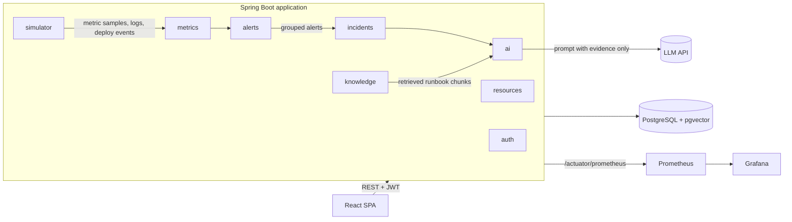
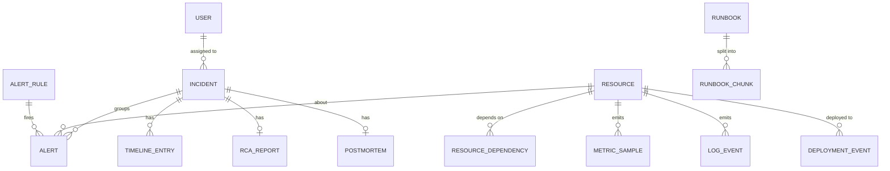

# CloudPilot — Design Document

| | |
|---|---|
| Author | Sudhanshu Singh Rajput |
| Status | Draft |
| Last updated | 2026-11-14 |

## 1. Problem

On-call engineers get flooded with alerts. One failing database can fire dozens of alerts
across the APIs and queues that depend on it. The engineer then has to answer three questions
under pressure:

1. **What failed?** Which alerts belong to the same problem?
2. **Why?** What does the evidence (metrics, logs, recent deployments) point to?
3. **What now?** Which runbook steps are safe to try first?

Today this means jumping between dashboards, log search and a wiki. Mean time to resolve (MTTR)
grows with every context switch.

## 2. Goals

- Show the health of every resource on one dashboard.
- Turn noisy alerts into a small number of incidents with a clear owner and status.
- Give the engineer an evidence-backed root-cause hypothesis with a confidence score and
  citations to the runbooks it used.
- Measure MTTR and SLA so the team can see whether things are improving.

## 3. Non-goals (out of scope for v1)

- Connecting to real AWS accounts. Resources and metrics are **simulated**, so the demo is free
  and repeatable. The ingestion API is designed so a real collector could replace the simulator.
- Running remediation automatically. The AI only **recommends**; humans act (see ADR-0002).
- Microservices, Kafka, Kubernetes deployment. A modular monolith is enough for the load we
  expect (see ADR-0001).
- Paging integrations (PagerDuty, SMS, Slack). Notifications stay in the app for v1.
- Multi-tenancy. One organisation per deployment.

## 4. Users and roles

| Role | Can do |
|---|---|
| **Admin** | Manage users, roles, alert rules and runbooks; everything an SRE can do |
| **SRE** | Acknowledge, assign, investigate and resolve incidents; approve postmortems; ask the AI |
| **Developer** | View dashboards and incidents; comment; ask the AI; cannot change incident state |

## 5. Success metrics

- An incident is created within **60 seconds** of its first alert.
- Related alerts are grouped: **one** incident per root failure in the seeded scenarios.
- AI analysis returns in under **10 seconds (p95)** and cites at least one source.
- Backend service-layer test coverage of **80%+**.

## 6. Architecture

CloudPilot is a **modular monolith**: one Spring Boot application and one database, split into
modules with clear boundaries. A module talks to another only through that module's public
service interface, never through its repositories or tables.

### Modules

| Module | Responsibility |
|---|---|
| `auth` | Users, roles, login, JWT issue and validation |
| `resources` | Cloud resources and the dependencies between them |
| `metrics` | Metric samples, log lines and deployment events |
| `simulator` | Generates normal traffic and failure scenarios |
| `alerts` | Alert rules, rule evaluation, alert events |
| `incidents` | Incident lifecycle, assignment, timeline, alert grouping |
| `knowledge` | Runbook upload, chunking, embeddings, retrieval |
| `ai` | Root-cause analysis and postmortem drafts; guardrails |

## 7. Data model (first draft)

Metric samples are the only high-volume table. They are written in batches and older samples
are deleted by a scheduled job (retention: 7 days), so plain PostgreSQL is enough.

## 8. API overview (v1)

| Method | Path | Role |
|---|---|---|
| POST | `/api/v1/auth/login` | public |
| GET | `/api/v1/resources` | any |
| GET | `/api/v1/resources/{id}/metrics?metric=&from=&to=` | any |
| GET / POST / PUT | `/api/v1/alert-rules` | read: any, write: Admin |
| GET | `/api/v1/alerts` | any |
| GET | `/api/v1/incidents` | any |
| POST | `/api/v1/incidents/{id}/acknowledge` | SRE, Admin |
| POST | `/api/v1/incidents/{id}/assign` | SRE, Admin |
| POST | `/api/v1/incidents/{id}/resolve` | SRE, Admin |
| GET | `/api/v1/incidents/{id}/timeline` | any |
| POST | `/api/v1/incidents/{id}/analysis` | any |
| POST | `/api/v1/incidents/{id}/postmortem` | SRE, Admin |
| POST | `/api/v1/runbooks` | Admin |
| GET | `/api/v1/reports/mttr` | any |

Full, generated documentation will be served by Swagger UI at `/swagger-ui.html`.

## 9. Key risks

| Risk | Mitigation |
|---|---|
| LLM invents a cause that the evidence doesn't support | Evidence-only prompt, required citations, answers without citations are marked low confidence |
| LLM output tells someone to run a destructive command | AI has no execution path; remediation steps are text only and labelled "verify before running" |
| No API key in a demo environment | Rule-based fallback analyser behind the same interface |
| Metric table grows without limit | Batched inserts, 7-day retention job, index on `(resource_id, metric, recorded_at)` |
